<p align="center"></p>

<p align="center">
  <b>Six animated themes for Claude Code.</b><br>
  Pick one in <code>/theme</code> and the whole CLI restyles: an animated scene above the prompt,<br>
  a boot banner, themed spinner words, prompt cards and more.<br>
  Plus an optional <a href="#desktop-hud">HUD for the desktop app</a> with a live progress bar.
</p>

<p align="center">
  <a href="#install">Install</a> ·
  <a href="#use-a-theme">Use a theme</a> ·
  <a href="#the-themes">The themes</a> ·
  <a href="#desktop-hud">Desktop HUD</a> ·
  <a href="#update-or-uninstall">Update or uninstall</a> ·
  <a href="#troubleshooting">Troubleshooting</a>
</p>

| | Theme | Pack | Look |
| --- | --- | --- | --- |
| ❀ | [**Sakura**](#sakura) | `theme-pack` | Red and white, cherry petals under a red sun |
| ϟ | [**Voltage**](#voltage) | `theme-pack` | Blue and yellow, current pulsing along a circuit board |
| ♛ | [**Royal**](#royal) | `theme-pack` | Purple and gold, sparkles over velvet |
| ◎ | [**Crunch**](#crunch) | `theme-pack` | Saturday-morning cereal: purple, lavender, sky blue, magenta and gold |
| ◆ | [**Xody**](#xody) | `theme-pack` | Red on black, embers rising off glowing coals |
| ▓ | [**Hacker**](#hacker) | `hacker-terminal` | Green on black, matrix rain and an "ACCESS GRANTED" banner |

## Install

You need Claude Code with plugin support. These themes are tested on Claude Code 2.1.316: check yours with `claude --version`, and update with `claude update`.

The themes come in two packs, so install one or both:

- `theme-pack`: Sakura, Voltage, Royal, Crunch and Xody
- `hacker-terminal`: Hacker

### In a Claude Code terminal session

Type these at the Claude Code prompt:

```
/plugin install theme-pack --marketplace CodySpooner/ClaudeCodeThemes
/plugin install hacker-terminal --marketplace CodySpooner/ClaudeCodeThemes
```

The first time, Claude Code asks to add the `claude-code-themes` marketplace: answer `y`. Then choose a scope: **user** installs the theme for all your projects.

### From a shell

```bash
claude plugin install theme-pack --marketplace CodySpooner/ClaudeCodeThemes
claude plugin install hacker-terminal --marketplace CodySpooner/ClaudeCodeThemes
```

### In the Claude desktop app

`/plugin` doesn't run in the desktop app. Instead:

1. Click **+** next to the prompt box, then **Plugins**.
2. Click **Add marketplace** and enter `CodySpooner/ClaudeCodeThemes`.
3. Click **Add plugin** for `theme-pack`, `hacker-terminal` or both.

## Use a theme

1. Run `/theme`.
2. Pick **Sakura**, **Voltage**, **Royal**, **Crunch**, **Xody** or **Hacker**. They're listed with Claude Code's own themes.
3. Start typing. The theme's banner greets you until your first prompt, and its scene keeps animating above the prompt.

To go back to normal, run `/theme` and pick one of Claude Code's own themes. All the extras switch off with it.

**Good to know**

- **Reduced motion:** with reduced motion turned on in Claude Code's settings, the scenes hold still.
- **Small windows:** in a narrow window the banner shrinks to a one-line title. When there's no room above the prompt, the scene steps aside instead of crowding it.
- **Desktop app:** the `theme-pack` themes draw their own animated strip above the prompt (shown under each theme below). Hacker's rain is terminal only, and it also skips light themes.
- **Fonts:** the scenes use symbols such as ❀ ϟ ♛ ✦ and halfwidth katakana. A terminal font with wide symbol coverage, like Cascadia Code or JetBrains Mono, draws them best.

## The themes

The pictures below are rendered from each theme's own drawing code, so the colours, banners and scenes are exactly what the theme draws. Each pair shows the screen when you start Claude Code (left, animated) and a session in progress (right).

### Sakura

Red and white. Cherry petals drift across the strip on a breeze, under a red sun.

<table><tr>
<td width="50%">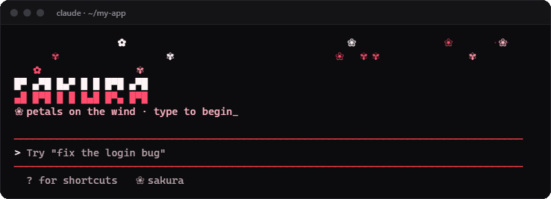</td>
<td width="50%">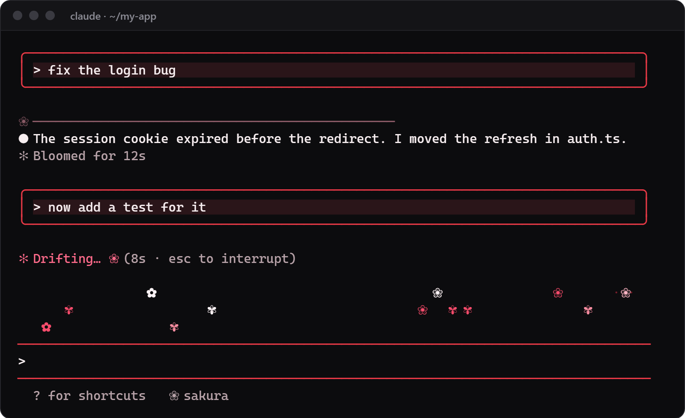</td>
</tr></table>

- **Spinner words:** Blooming, Drifting, Folding, Unfurling, Blossoming, Steeping
- **Desktop app strip:**

  

### Voltage

Blue and yellow. Current pulses along the traces of a circuit board.

<table><tr>
<td width="50%">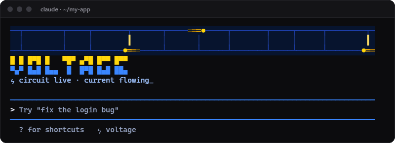</td>
<td width="50%">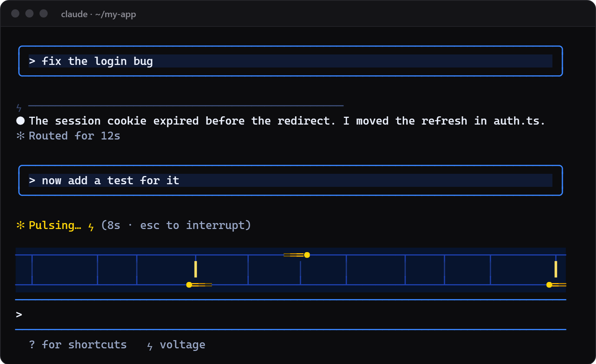</td>
</tr></table>

- **Spinner words:** Routing, Pulsing, Soldering, Charging, Arcing, Amplifying, Overclocking
- **Desktop app strip:**

  

### Royal

Purple and gold. Gold sparkles twinkle over velvet, above a shimmering gold fringe.

<table><tr>
<td width="50%">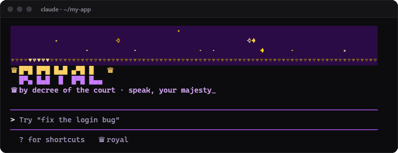</td>
<td width="50%">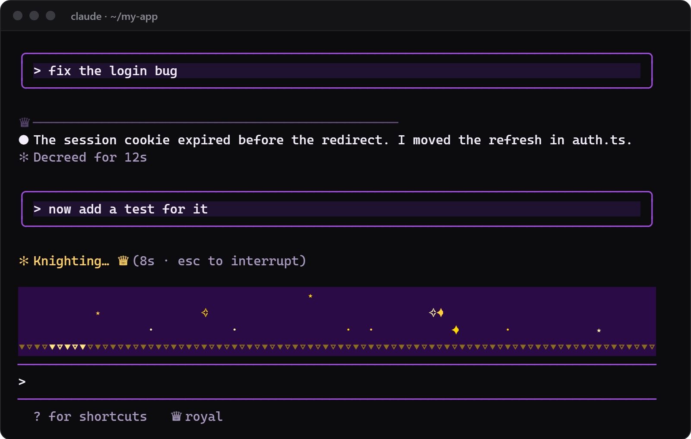</td>
</tr></table>

- **Spinner words:** Decreeing, Knighting, Crowning, Proclaiming, Gilding, Summoning the court
- **Desktop app strip:**

  

### Crunch

A Saturday-morning cereal look in deep purple, lavender, sky blue, magenta and gold. Cereal loops tumble into a wave of milk while a spoon swoops through.

Crunch also restyles the conversation: your prompts get a "✦ you" label, each reply opens with a gold "◎ claude" pill, and every turn ends with a decorated footer.

<table><tr>
<td width="50%">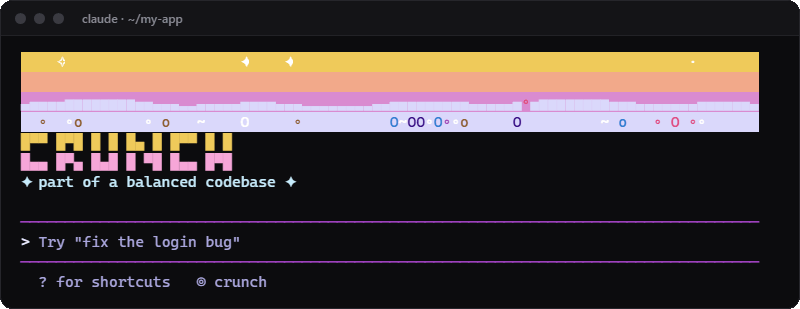</td>
<td width="50%">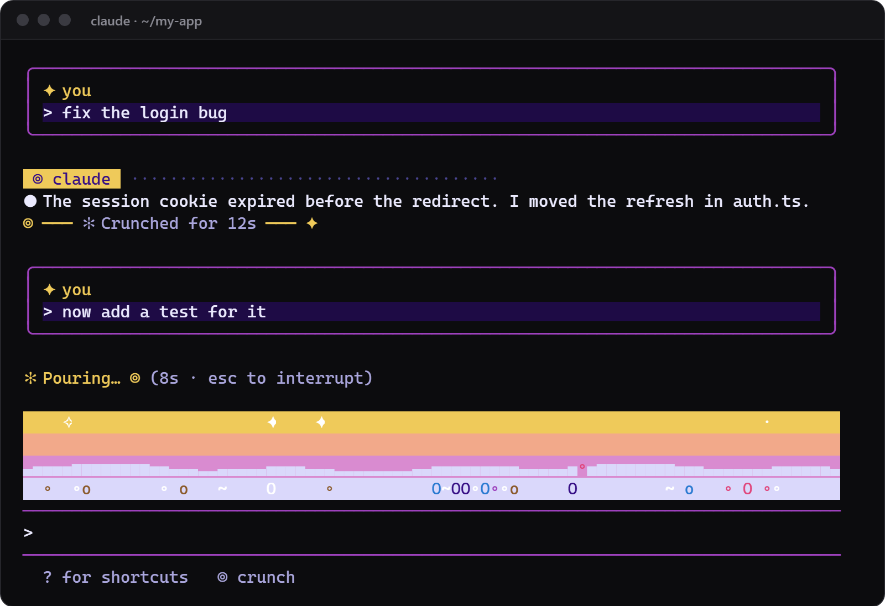</td>
</tr></table>

- **Spinner words:** Crunching, Pouring, Spooning, Sprinkling, Toasting, Frosting, Stirring the bowl
- **Desktop app strip:**

  

### Xody

Red on black. Embers rise off a bed of glowing coals, cooling from gold to deep red as they climb, under a XODY banner.

<table><tr>
<td width="50%">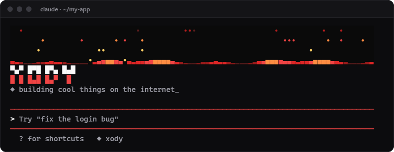</td>
<td width="50%">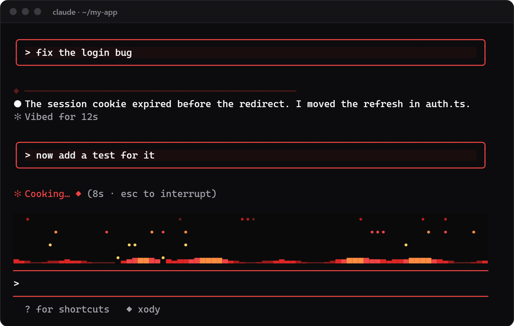</td>
</tr></table>

- **Spinner words:** Vibing, Cooking, Shipping, Igniting, Forging, Stoking the fire
- **Desktop app strip:**

  

### Hacker

Green on black. Matrix rain falls above the prompt, and an "ACCESS GRANTED" banner greets you until your first prompt. Hacker comes in its own pack, `hacker-terminal`.

<table><tr>
<td width="50%">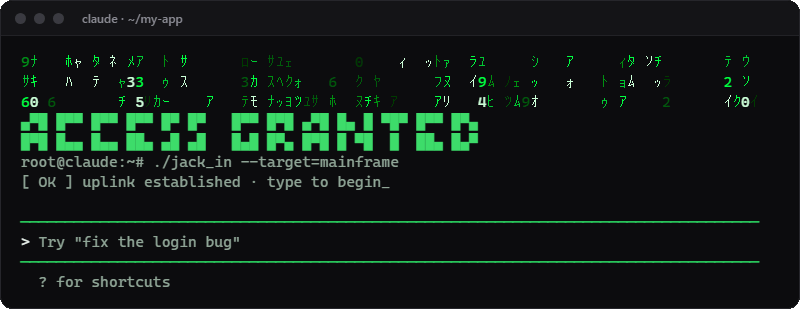</td>
<td width="50%">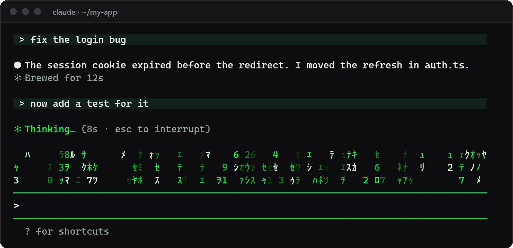</td>
</tr></table>

### What each theme changes

| | Sakura, Voltage, Royal, Crunch, Xody | Hacker |
| --- | :---: | :---: |
| Colours across Claude Code | ✓ | ✓ |
| Animated scene above the prompt | ✓ | ✓ |
| Boot banner until your first prompt | ✓ | ✓ |
| Themed spinner and "done" words | ✓ | |
| Your prompts framed in cards | ✓ | |
| A themed divider opening each reply | ✓ | |
| Theme badge next to your modes | ✓ | |
| Animated strip in the desktop app | ✓ | |

## Desktop HUD

`desktop-hud` is an optional extra for the Claude desktop app. It works with any theme, and each theme here gets its own look.

<p></p>

Install it the same way as the themes: click **Add plugin** for `desktop-hud` in the desktop app, or run this from a shell:

```bash
claude plugin install desktop-hud --marketplace CodySpooner/ClaudeCodeThemes
```

### The activity bar

The bar sits above the prompt and shows what Claude is doing. It stays calm while Claude is idle, picks up while Claude works, and fires a burst on every tool call.

| Theme | Scene | On each tool call |
| --- | --- | --- |
| Hacker | Digital rain and a live signal trace | A scan bar sweeps across |
| Sakura | Blossoms swaying in front of a setting sun | A blossom bursts into petals |
| Voltage | An LED meter under crackling arcs | A lightning strike |
| Royal | Gold organ pipes with jewel caps on velvet | A crown in a shower of stars |
| Crunch | Stacks of cereal loops leaping out of milk | A spoon swoops through |
| Xody | Layers of flame throwing embers | A fireball |

Any other theme gets ribbons in Claude's own colours.

### The progress rail

The rail under the scene shows how far along Claude is: one segment for each step of its task list, and one dot for each subagent. Finished pieces are filled and the current step fills on a loop. Failed subagents turn red. Hover over a piece to see its name.

The rail counts finished steps instead of showing a percentage, because Claude Code can't tell how far through a step Claude is. It only appears when Claude has a task list or subagents.

### The panels

| Command | What it opens |
| --- | --- |
| `/dash` | Tokens per turn, context used, cost and the tools Claude called |
| `/files` | A heatmap of the files Claude read or edited this session |
| `/actions` | A dock of one-click commands and saved prompts. Edit `desktop-hud/hooks/actions.ts` to change them |
| `/hud` | All three |

The panels also work in the terminal, where `/dash` falls back to text. The activity bar and the progress rail are desktop only.

## Update or uninstall

To update, run this, then restart Claude Code:

```bash
claude plugin update theme-pack@claude-code-themes
```

To uninstall, run this, then pick another theme in `/theme`:

```bash
claude plugin uninstall theme-pack@claude-code-themes
```

For Hacker, use `hacker-terminal@claude-code-themes` instead, and for the HUD, `desktop-hud@claude-code-themes`. In a session, `/plugin` does the same from a menu.

## Troubleshooting

- **The themes aren't listed in `/theme`:** run `/reload-plugins` or restart Claude Code. `claude plugin list` shows whether the pack is installed and enabled.
- **Nothing moves:** reduced motion is on, or the window is too short for the scene, which needs 3 or 4 free rows above the prompt.
- **Boxes instead of petals or katakana:** your terminal font is missing those symbols. Switch to a font with wider symbol coverage.
- **The banner disappeared:** it only shows until your first prompt, and comes back in your next session.
- **No progress rail:** it only appears when Claude has a task list or subagents, and only in the desktop app with `desktop-hud` installed.

## Repository layout

```
ClaudeCodeThemes/
├── .claude-plugin/marketplace.json   the marketplace, listing the packs and the HUD
├── theme-pack/                       Sakura, Voltage, Royal, Crunch and Xody
│   ├── .claude-plugin/plugin.json
│   ├── hooks/register.tsx            draws the scene, banner, cards, divider and spinner words
│   ├── hooks/looks.ts                each look: banner, colours, scene and desktop strip
│   ├── themes/*.json                 the colour themes that /theme lists
│   └── tests/
├── hacker-terminal/                  Hacker, laid out the same way
├── desktop-hud/                      the activity bar, progress rail and panels
│   ├── hooks/register.tsx            tracks the session and draws the band and panels
│   ├── hooks/bars.ts                 each theme's activity bar and the progress rail
│   ├── hooks/charts.ts               the dashboard's charts
│   ├── hooks/actions.ts              the buttons in the /actions dock
│   └── tests/
└── docs/images/                      the pictures in this README
```

## Development

Clone the repo, then try your changes in a session that loads the pack straight from the folder:

```bash
claude --plugin-dir ./theme-pack
```

To check your changes:

```bash
claude plugin test theme-pack
claude plugin validate theme-pack
```

To add a look to `theme-pack`, add its colours as `theme-pack/themes/<key>.json` and its scene, banner and words as `<key>` in `LOOKS` in `theme-pack/hooks/looks.ts`.

---

<p align="center">Made by <a href="https://github.com/CodySpooner">Xody</a> · <a href="LICENSE">MIT license</a></p>
